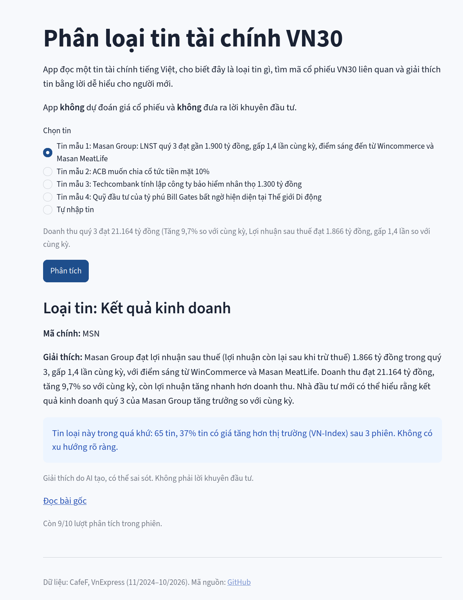
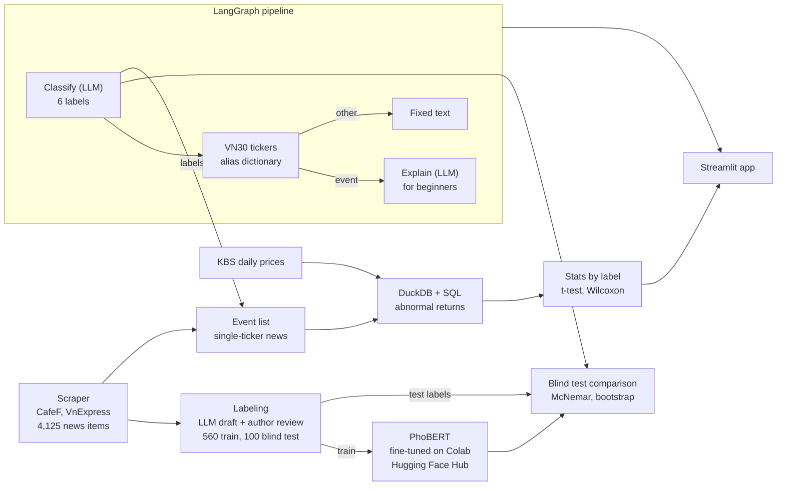

# Financial News Event Classifier


Classifies Vietnamese financial news about VN30 stocks into event types, comparing
an LLM pipeline with a fine-tuned PhoBERT model. An event study then measures how
stock prices reacted to each event type, and a Streamlit app explains any news
item in plain Vietnamese for beginner investors.

**Live demo:** [Streamlit app](https://financial-news-event-classifier-jmrqhpn6woqpxcfssh4ifm.streamlit.app/)



## Architecture



- **Labeling**: an LLM drafts a label for every news item; the author reviews the
  training set and labels the test set blind.
- **LangGraph pipeline**: one LLM call classifies the news, a dictionary finds the
  VN30 tickers named in the title, and a second LLM call explains event news for
  beginners (`other` news gets a fixed text). This powers the app.
- **PhoBERT** is trained on the same labels and compared with the LLM classifier
  on the blind test set.
- **Event study**: news tied to one VN30 ticker, labeled by a human or the LLM, is
  joined with daily prices in DuckDB; abnormal returns are computed in SQL and
  summarized by label. The app shows this summary next to each result.

## Data

- **Sources:** CafeF and VnExpress (Kinh doanh), November 2024 to October 2026:
  4,125 news items (title, sapo, date, url).
- **6 labels** (full definitions in [docs/labeling_guide.md](docs/labeling_guide.md)):

| Label | Meaning |
|---|---|
| `business_results` | Revenue, profit, operating figures, and company targets for them |
| `dividends_issuance` | Cash or stock dividends, new share issues, buybacks |
| `macro_policy` | Interest rates, SBV decisions, inflation, GDP, credit, taxes and tariffs |
| `ma_investment` | M&A and corporate investment, including new projects and capacity expansion (greenfield) |
| `legal_personnel` | Fines, lawsuits, violations; leadership changes (board, CEO) |
| `other` | No event of the types above (market reports, insider trades, bonds, ...) |

- **Labeling** ([docs/data_process.md](docs/data_process.md)):
  - An LLM pre-labeled every item. The author reviewed 560 items one by one and
    changed 12% of the labels. This is the training set.
  - Test set: 100 items labeled blind by the author, without seeing the LLM
    labels. It was never used to tune prompts, the guide or the model.

## Results

Full details: [docs/results.md](docs/results.md).

### Classification (blind test set, 100 items)

| | LLM v2 (gpt-6-luna) | PhoBERT (seed 44) |
|---|---|---|
| Macro-F1 | 0.793 | 0.767 (3 seeds: 0.774 ± 0.012) |
| Accuracy | 0.800 | 0.800 |
| Time per item | 2.5 s (API) | 0.045 s (laptop CPU) |
| Cost per 1,000 items | about $0.22 | $0 |

- **No significant difference** between the two models: McNemar p = 1.00 (8
  items only PhoBERT gets right, 8 only the LLM), and the bootstrap 95% CI of the
  macro-F1 difference (-0.11 to 0.06) contains 0.
- PhoBERT is about 55x faster and free to run. The LLM is better on `other`;
  PhoBERT is better on `macro_policy`.
- The LLM cost uses a gpt-6-luna price from aggregator sites, not yet checked on
  OpenAI's pricing page.

### Event study (169 events, 27 tickers)

Abnormal return (AR) = stock return minus VN-Index return over 1, 3 and 5
sessions after the news (news after 15:00 counts from the next session).

- **No event type has an AR clearly different from 0.** Every 95% CI in the full
  sample contains 0.
- Without VIC (the most frequent ticker), `ma_investment` shows a negative AR at
  3 sessions (-0.78%, p = 0.038). With 12 tests per sample this is only a hint:
  it is not significant after a Bonferroni correction.
- Likely reasons:
  1. Good and bad news share a label and cancel out (record profits and losses
     are both `business_results`).
  2. Prices may move before the news is published.
  3. Small samples (22-65 events per label), and 79% of the labels come from the
     LLM, which is about 80% accurate.

## Limitations

- The test set is small (100 items) and under-represents `other` (21% vs. about
  54% in real news), so scores have wide confidence intervals.
- One person labeled all the data.
- 79% of the event study labels come from the LLM, not from a human.
- PhoBERT often misses `other` (recall 0.29-0.38), which matters on real news.
- Labels and main tickers are decided mostly from the title, so details only in
  the sapo can be missed.
- The explanations sometimes misuse a financial term (e.g. calling a divestment
  gain "proceeds"); 18 of 20 reviewed explanations were correct.

## Future work

- Add a good/bad sentiment label and measure AR by event type and direction.
- Combine PhoBERT and the LLM (e.g. PhoBERT first, LLM for unsure items).
- Label more `other` news to improve PhoBERT on real-world data.

## Tech stack

Python, pandas, requests + BeautifulSoup (scraping), OpenAI API + Pydantic
(structured output), LangGraph, PhoBERT with Hugging Face Transformers (trained
on Colab, model on the [Hugging Face Hub](https://huggingface.co/MaiDoanThanhThuy/phobert-vn30-news-events)),
DuckDB + SQL (event study), SciPy, Streamlit, pytest + ruff + GitHub Actions.

## How to run

```bash
conda create -n financial-news python=3.11 && conda activate financial-news
pip install -r requirements.txt -r requirements-dev.txt
echo "OPENAI_API_KEY=sk-..." > .env

streamlit run app/app.py               # demo app
pytest -q && ruff check .              # tests and lint
```

Main steps (the raw news and prices are not committed; scraping and the LLM cost
money and time):

```bash
python -m src.scraping.scrape                    # 1. raw news -> data/raw/news.csv
python -m src.classify.llm_label                 # 2. LLM pre-labels
python -m src.classify.llm_test                  # 3. LLM on the blind test set
python -m src.classify.evaluate                  #    scores
python -m src.finetune.test_phobert              # 4. PhoBERT on the test set (needs requirements-finetune.txt)
python -m src.classify.compare                   #    McNemar + bootstrap
python -m src.event_study.build_events run       # 5. label single-ticker news
python -m src.event_study.build_events events    #    filter events
python -m src.event_study.fetch_prices           #    prices from KBS
python -m src.event_study.load_prices            #    load into DuckDB
python -m src.event_study.event_returns          #    abnormal returns (SQL)
python -m src.event_study.summary                #    stats by label
```

PhoBERT training runs on Colab: [notebooks/finetune_colab.ipynb](notebooks/finetune_colab.ipynb).
Event study charts: [notebooks/event_study.ipynb](notebooks/event_study.ipynb).

## Project structure

```
app/            Streamlit app
src/scraping/   news scraper
src/classify/   LLM labeling, tickers, explanations, LangGraph pipeline, evaluation
src/finetune/   PhoBERT training and prediction
src/event_study/ event list, prices, abnormal returns (SQL), statistics
src/demo/       app helpers
data/labeled/   human-reviewed train set and blind test set
docs/           plan, labeling guide, data process, results
```
